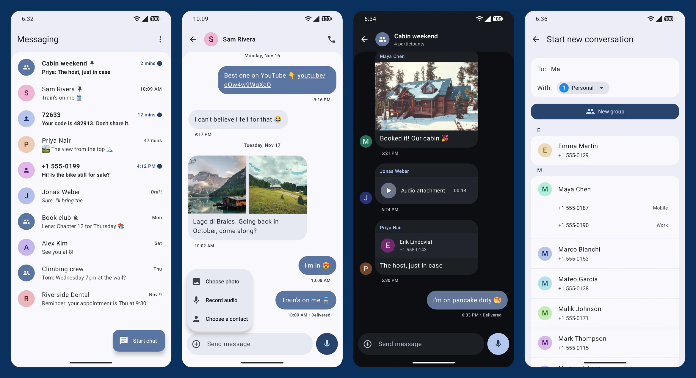

# Messaging

The SMS and MMS app of GrapheneOS.
It started out as the AOSP Messaging app and is being rewritten in Kotlin and Jetpack Compose.



## Checks

Pull requests have to pass these:

```sh
./gradlew ktlintCheck :app:detektDebug
./gradlew :app:testDebugUnitTest
./gradlew :app:connectedDebugAndroidTest
```

CI also enforces a minimum test coverage, see [`build.yml`](.github/workflows/build.yml).
